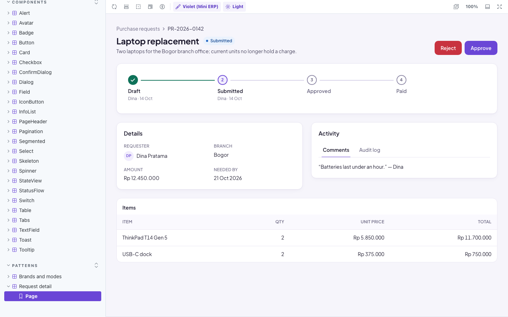
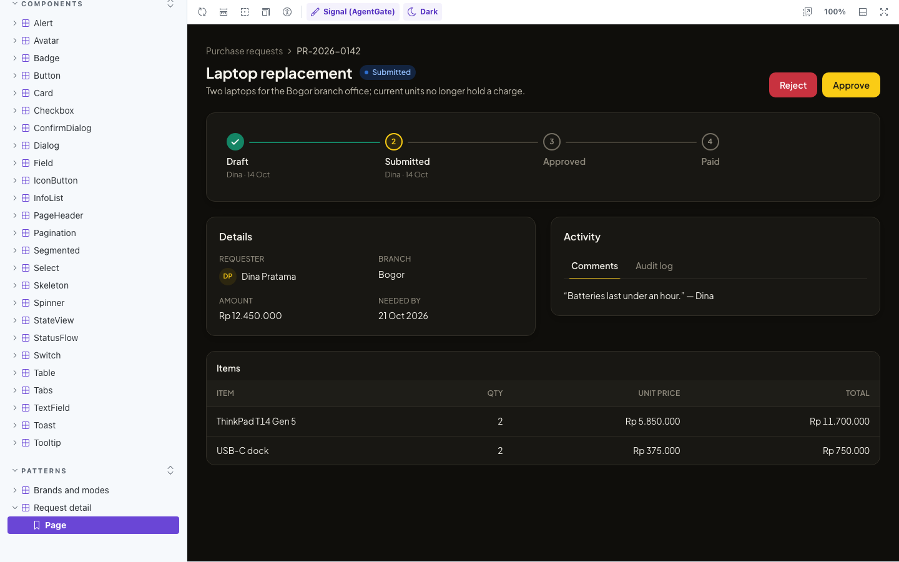
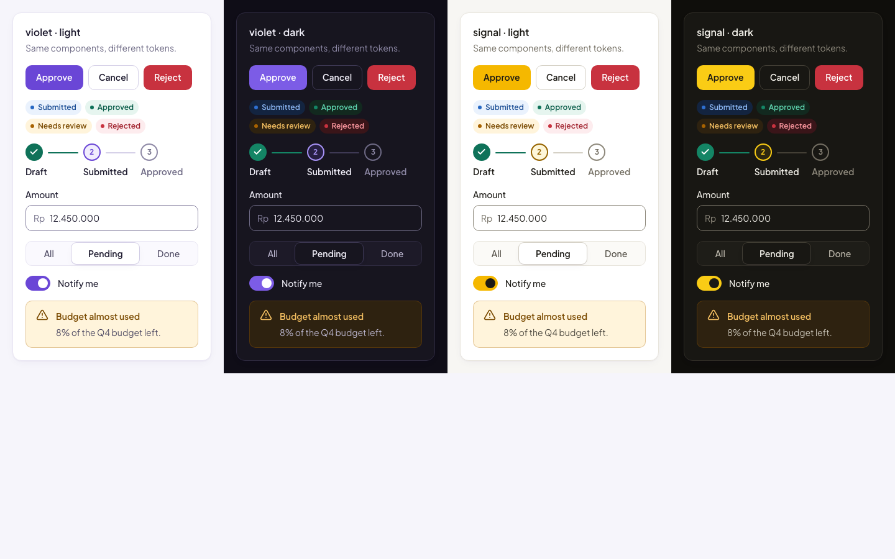
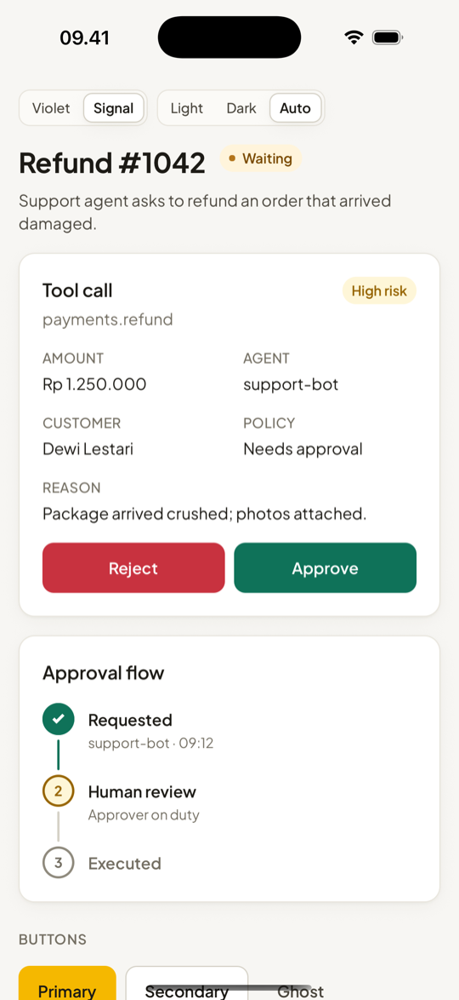
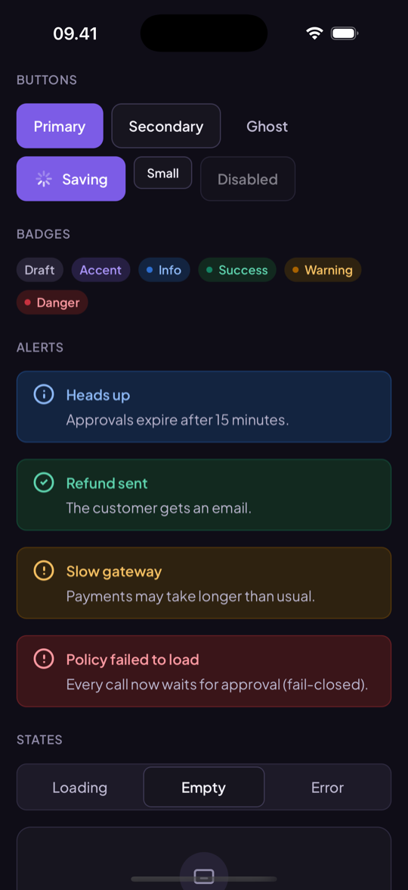
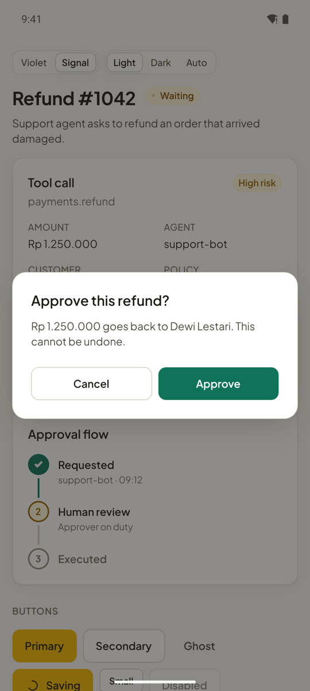

# Rupa

**A multi-brand design system: tokens from one source, accessible React and React Native components, documented in Storybook, and guarded by visual regression tests.**

**[Live Storybook](https://raihan-evanza-rupa.vercel.app)** · [`@rupa-ui/react`](https://www.npmjs.com/package/@rupa-ui/react) · [`@rupa-ui/react-native`](packages/react-native) · [`@rupa-ui/tokens`](https://www.npmjs.com/package/@rupa-ui/tokens)

[](https://www.npmjs.com/package/@rupa-ui/react) [](https://www.npmjs.com/package/@rupa-ui/tokens) [](https://github.com/raihanevanza/rupa/actions/workflows/ci.yml)

_Rupa_ is Indonesian for _form, appearance_. It powers my portfolio apps: Mini ERP (violet brand), AgentGate (signal brand), and Dompet Rumah (latte brand) share one set of tokens and components instead of copying them.



| Same page, signal brand in dark mode                            | Brands and modes, nested on one page                              |
| --------------------------------------------------------------- | ----------------------------------------------------------------- |
|  |  |

**Android and iOS** (`@rupa-ui/react-native`, same tokens and props):

| iOS, signal brand                                                  | iOS, violet brand in dark mode                                   | Android, ConfirmDialog                                                  |
| ------------------------------------------------------------------ | ---------------------------------------------------------------- | ----------------------------------------------------------------------- |
|  |  |  |

## Features

- **Design tokens, one source.** DTCG JSON → Style Dictionary → CSS variables, Tailwind v3 preset, Tailwind v4 theme, typed JS, and a React Native palette. Web and mobile can no longer drift.
- **Multi-brand, light and dark, nestable.** Every color is a `light-dark()` pair per brand. Set `data-brand` and `data-theme` on any element; nested scopes just work, with no selector combinations.
- **27 accessible components.** Button, IconButton, Badge, Card, PageHeader, InfoList, StatusFlow, Segmented, Tabs, TextField, Select, Input, Textarea, NativeSelect, Checkbox, Switch, Dialog, ConfirmDialog, Toast, Alert, Tooltip, Pagination, Table, StateView, Spinner, Skeleton, Avatar, plus `Field` and `ThemeProvider`.
- **React Native for Android and iOS.** `@rupa-ui/react-native` has ThemeProvider, Button, Badge, Card, PageHeader, InfoList, StatusFlow, Segmented, ConfirmDialog, Alert, StateView, and Spinner, built on the same palette and props as the web. No native modules, so it runs in Expo Go, and in [Storybook](https://raihan-evanza-rupa.vercel.app/?path=/story/react-native-overview--screen) through react-native-web, where the stories get the same axe, interaction, and screenshot tests as the web components. Also tested with Jest + React Native Testing Library and on an iPhone simulator and an Android emulator.
- **Accessibility checked in CI.** Every story, web and React Native, runs axe in all six themes (948 runs). Keyboard behavior is tested with play functions. A script checks 282 contrast pairs per build, and the chart palette is validated for color-vision deficiency.
- **Visual regression.** 280 screenshots (every story, light and dark) are compared on each pull request, rendered in the same Linux image locally and in CI.
- **Release pipeline.** Changesets → Release PR → npm publish with provenance (trusted publishing, no stored token).

## Used by

- **[AgentGate](https://raihan-evanza-agentgate.vercel.app/?as=approver)** (signal brand): tokens via the Tailwind v3 preset, and its Button, Card, Dialog, ConfirmDialog, PageHeader, InfoList, Segmented, badges, Pagination, form controls, and loading/empty/error states wrap `@rupa-ui/react`. The migration found five gaps, all fixed in 0.3.x: bare `Input`/`Textarea`/`NativeSelect`, `Badge pulse`, `StateView description={null}` showing English text, focus not returning after a dialog opened from state, and child icons wrapping under Tailwind's preflight.

## What the checks caught

Building the pipeline surfaced real issues in the palettes the apps had been copying:

| Check              | Finding                                                                          | Fix                                             |
| ------------------ | -------------------------------------------------------------------------------- | ----------------------------------------------- |
| Contrast script    | AgentGate links on `accent-soft` were 4.49:1, just under AA                      | Gold `#9a6700` → `#966400`                      |
| Chart validator    | AgentGate series 5 (slate) read as gray; blue sat next to teal (ΔE 14.9)         | New order: amber, teal, violet, rose, blue      |
| Keyboard test      | Dialog opened with focus on the close button instead of the first field          | Close button moved last in DOM, drawn top-right |
| Size limit         | Importing only `Button` pulled in Radix: 21 kB                                   | Per-module output: 492 B                        |
| Types check (attw) | Declaration files used extensionless imports that fail under Node ESM resolution | `.js` extensions in source imports              |

## Tech stack

| Area           | Tools                                                                                      |
| -------------- | ------------------------------------------------------------------------------------------ |
| Tokens         | Style Dictionary 5 (DTCG), custom formats, Lightning CSS                                   |
| Components     | React 18/19, TypeScript (strict), plain CSS with tokens, Radix (Dialog, Tooltip)           |
| Docs           | Storybook 10 (autodocs, MDX, a11y addon, brand/mode toolbar)                               |
| Tests          | Vitest browser mode + Playwright (stories, interactions, axe), Playwright visual snapshots |
| Package checks | publint, Are The Types Wrong, size-limit                                                   |
| Release        | Changesets, GitHub Actions, npm provenance                                                 |

## Repository

```text
.
├── packages/
│   ├── tokens/        # src/*.json → scripts/build.ts → dist/ (css, tailwind, js, react-native)
│   │   └── scripts/   # build, check-contrast, check-chart
│   ├── react/         # src/components/<Name>/{Name.tsx, Name.css, Name.stories.tsx}
│   └── react-native/  # src/components/<Name>/{Name.tsx, Name.test.tsx}
├── apps/docs/         # Storybook: foundations, guides, patterns
├── examples/mobile/   # Expo app that runs the React Native sources (own lockfile)
├── tests/visual/      # Playwright screenshots of every story + Docker runner
├── .changeset/
└── docs/              # spec.md, screenshots/
```

## Getting started

Requires Node 22 (`nvm use`) and Docker for visual baselines.

```sh
npm install
npm run dev            # build tokens, then Storybook on http://localhost:6006
```

| Command                                 | What it does                                                          |
| --------------------------------------- | --------------------------------------------------------------------- |
| `npm run build`                         | Build `@rupa-ui/tokens`, `@rupa-ui/react`, `@rupa-ui/react-native`    |
| `npm test`                              | Token checks, every story (render, play, axe), React Native Jest      |
| `npm run test:themes -w @rupa-ui/docs`  | The story tests in all six brand × mode themes                        |
| `npm run test:visual:docker`            | Compare screenshots with the baselines (Linux, in Docker)             |
| `npm run test:visual:update`            | Re-create baselines after an intended visual change                   |
| `npm run typecheck`, `npm run lint`     | TypeScript, ESLint (incl. jsx-a11y), and the "no raw CSS values" lint |
| `npm run check:package`, `npm run size` | publint, type resolution, size budgets                                |
| `npm run changeset`                     | Describe a change for the changelog                                   |

## Using it in an app

```sh
npm install @rupa-ui/react
```

```tsx
import '@rupa-ui/react/styles.css'
import { Button, ConfirmDialog } from '@rupa-ui/react'

// <html data-brand="signal" data-theme="dark">
;<ConfirmDialog
  trigger={<Button variant="danger">Reject</Button>}
  tone="danger"
  title="Reject this request?"
  confirmLabel="Reject"
  onConfirm={() => api.reject(id)} // buttons lock until the promise settles
/>
```

React Native (Android and iOS):

```tsx
import { ThemeProvider, Button, ConfirmDialog } from '@rupa-ui/react-native'

;<ThemeProvider defaultBrand="signal" defaultMode="system">
  <ConfirmDialog
    open={open}
    onOpenChange={setOpen}
    tone="danger"
    title="Reject this request?"
    confirmLabel="Reject"
    onConfirm={() => api.reject(id)}
  />
</ThemeProvider>
```

Font setup and the full component list: [react-native README](packages/react-native/README.md). Try it with `cd examples/mobile && npm install && npm run ios` (or `android`).

Tailwind setup: see **Getting started** in Storybook or the [tokens README](packages/tokens/README.md).

## Adding a component

1. `packages/react/src/components/<Name>/` with `<Name>.tsx`, `<Name>.css` (tokens only), `<Name>.stories.tsx`.
2. Export it from `src/index.ts` and import the CSS in `src/styles.css` (the CSS lint fails otherwise).
3. Stories for every variant; a play function for any keyboard interaction.
4. `npm test`, then `npm run test:visual:update` and review the new screenshots.
5. `npm run changeset`.

## Deploy

- **Storybook:** [raihan-evanza-rupa.vercel.app](https://raihan-evanza-rupa.vercel.app), deployed by Vercel on every push to `main` (`vercel.json`: build `npm run build:docs`, output `apps/docs/storybook-static`).
- **npm:** published from `.github/workflows/release.yml` with npm trusted publishing (OIDC). Merging the Release PR that Changesets opens is the only manual step.

## Next

- [ ] Manual screen reader pass (VoiceOver + Safari) on Dialog, Tabs, Toast
- [x] Migrate AgentGate to Rupa (spec FR-11)
- [ ] Migrate Mini ERP (violet brand)
- [x] React Native components (spec FR-12): 11 components + ThemeProvider
- [ ] Migrate AgentGate mobile to `@rupa-ui/react-native`
- [ ] Manual VoiceOver + TalkBack pass on the React Native components

## Spec

How this project went from requirements to implementation: [docs/spec.md](docs/spec.md).

## License

MIT
