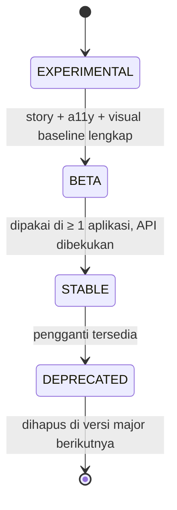

# Spec — Rupa

Disalin dari `spec-template-proyek-portofolio.md`. Bagian A adalah standar tetap; penyimpangannya untuk proyek ini dicatat di B1.

---

# Bagian A — Standar tetap

## A1. Stack default

| Bagian   | Default                                                                                                                              | Catatan                                                                               |
| -------- | ------------------------------------------------------------------------------------------------------------------------------------ | ------------------------------------------------------------------------------------- |
| Web      | React 18 + TypeScript + Vite, Tailwind CSS, Redux Toolkit + RTK Query, React Router, react-hook-form + yup, lucide-react             | Alternatif yang sah: Vue 3 + Pinia bila proyek menonjolkan Vue                        |
| Mobile   | React Native versi stabil terbaru (New Architecture, Hermes), React Navigation 7, RTK Query, react-native-keychain, react-native-svg | Android dan iOS dari satu kode. Jangan mulai dari RN yang sudah di luar masa dukungan |
| Backend  | Go + Gin + GORM, Viper, JWT, Swaggo, Testify + GoMock (pola `be-api-template`)                                                       | REST + JSON. Tambah gRPC hanya bila memang ditonjolkan                                |
| Database | SQL Server atau PostgreSQL di Docker (Colima)                                                                                        | Schema + seed dev di `db/`                                                            |
| Tooling  | ESLint, Prettier, Husky + lint-staged, TypeScript strict                                                                             | Node lewat nvm (`.nvmrc`)                                                             |

## A2. Struktur repo (monorepo)

```text
.
├── frontend/   # web
├── mobile/     # React Native (android/, ios/, src/)
├── backend/    # Go: api/{controller,middleware,route}, pkg/{usecase,repository,model,errs,i18n}
├── db/         # docker-compose, init/01_schema.sql, init/02_seed_dev.sql
└── docs/       # spec.md, screenshots/, (mobile-requirements.md bila ada mobile)
```

## A3. Arsitektur

- **Backend:** alurnya controller → usecase → repository. Aturan bisnis hanya ada di usecase. Transaksi DB dibawa lewat `ctx`. Setiap perubahan status dijaga kondisi status asal, supaya dua request bersamaan tidak memproses dokumen yang sama dua kali.
- **Format respons:** `{ error: {error_code, title, message} | null, message, data }`. Daftar berhalaman memakai `data.data` dan `data.pagination`.
- **Permission:** didefinisikan di satu tempat saja di backend (role → permission). Frontend dan mobile membacanya dari `GET /auth/me`, tidak menulis role secara hard-code.
- **Web:** folder `api/` (client + RTK Query), `features/`, `pages/`, `components/`, `i18n/`, `lib/`.
- **Mobile:** folder `src/app` (store, navigasi, env), `src/core` (api, auth, i18n, theme, format), `src/shared` (UI), `src/features`. Layar tidak memanggil `fetch` dan tidak membaca token secara langsung.
- **Satu pintu ke backend** (web maupun mobile): header standar (`Authorization`, `Accept-Language`, `X-Platform`), timeout, buka envelope, dan normalisasi error ke `network | timeout | unauthenticated | forbidden | notFound | conflict | validation | server`.

## A4. Fitur dasar wajib

Semua proyek harus punya ini sebelum dianggap layak masuk portofolio.

- [ ] Login dengan JWT; sesi disimpan aman (`localStorage` di web, Keychain/Keystore di mobile); 401 mengembalikan pengguna ke halaman login.
- [ ] Hak akses per role, ditegakkan di backend dan tercermin di UI (menu dan tombol disembunyikan bila tidak berhak).
- [ ] Minimal satu **alur status** dengan transisi yang dijaga (mis. Draft → Submitted → Approved/Rejected) dan pemisahan tugas (pembuat tidak bisa meng-approve dokumennya sendiri).
- [ ] Jejak audit untuk aksi penting.
- [ ] Setiap daftar punya pencarian, filter status, dan paginasi (web: tabel; mobile: infinite scroll + pull-to-refresh).
- [ ] Dashboard berisi KPI dan 1–2 grafik, dengan tampilan tabel sebagai alternatif aksesibel.
- [ ] Dua bahasa (ID/EN); pesan error backend ikut bahasa yang dipilih (`Accept-Language`).
- [ ] Mode gelap.
- [ ] Kartu **akun demo** di halaman login yang mengisi email dan password sekali tap/klik; dimatikan lewat flag di produksi.
- [ ] Keadaan loading, kosong, error + coba lagi yang konsisten di semua layar.
- [ ] Aksi yang tidak bisa dibatalkan selalu memakai dialog konfirmasi, kunci terhadap double tap, dan membaca ulang data setelah 409 atau timeout.

## A5. Design system

- Token warna sebagai CSS variable (web) dan objek `Palette` (mobile), dengan versi terang dan gelap. Boleh memakai palet violet Mini ERP atau membuat brand baru, asal **satu sumber** dipakai di web dan mobile.
- Font yang sama di web dan mobile (Mini ERP memakai Plus Jakarta Sans, OFL). Di mobile pakai helper `font(weight)`, bukan `fontWeight`.
- Palet seri grafik **divalidasi** (kontras + aman buta warna) dengan validator dataviz sebelum dipakai; urutan warna seri tetap.
- Komponen yang setara di web dan mobile: PageHeader, Card, Badge berbulatan, Button (primary/secondary/danger/success), StatusFlow, InfoList, ConfirmDialog, Segmented.
- Tiap komponen dicek dalam mode terang dan gelap.

## A6. Standar kualitas

| Area          | Standar                                                                                                                                                            |
| ------------- | ------------------------------------------------------------------------------------------------------------------------------------------------------------------ |
| Tipe & lint   | TypeScript strict, ESLint, Prettier; `typecheck` dan `lint` bersih                                                                                                 |
| Test          | Aturan bisnis diuji unit test: usecase di backend; logika keputusan, mapping error, i18n, dan format di frontend/mobile                                            |
| CI            | GitHub Actions menjalankan typecheck, lint, test, dan build untuk setiap folder yang berubah                                                                       |
| Keamanan      | Password di-hash bcrypt; respons login seragam (cegah user enumeration); `JWT_SECRET` dari env; CORS dibatasi; seed demo hanya untuk dev; tidak ada secret di repo |
| Aksesibilitas | Label pada input dan tombol ikon; status tidak hanya dibedakan lewat warna; target sentuh minimal 44 px                                                            |
| Verifikasi    | Setiap fitur dicoba langsung (browser, emulator, simulator) sebelum dianggap selesai, bukan hanya lolos test                                                       |

## A7. Deliverable portofolio

- **README root:** gambar utama → fitur → alur status → tech stack → struktur folder → cara menjalankan (DB → backend → web → mobile) → akun demo → konfigurasi → testing → deploy → checklist sebelum produksi.
- **Screenshot:**
  - Web: 1440×900, terang dan gelap, setelah login dengan data seed yang representatif.
  - Mobile: lebar 540 px, status bar disetel ke 9:41 dengan baterai penuh (Android: demo mode SystemUI; iOS: `simctl status_bar override`). Android dan iOS keduanya.
  - Simpan di `docs/screenshots/` (mobile di `docs/screenshots/mobile/`).
- **Video demo** 30–60 detik untuk alur utama, untuk kartu proyek di situs portofolio.
- **Live demo:** frontend di Vercel (root `frontend`), backend di host yang dicatat di README, dan akun demo aktif.
- **Spec** (`docs/spec.md`) ikut di-commit, sebagai bukti cara kerja dari requirement ke implementasi.
- **Kartu proyek** di `~/Kerjaan/portfolio/src/data.js`: judul, ringkasan, tag stack, link repo/live/video, screenshot.

## A8. Catatan lingkungan (Mac 8 GB ini)

- Node 22 lewat nvm; RN terbaru butuh Node ≥ 22.11. Tambahkan `.nvmrc`.
- Docker lewat Colima (4 GB). Gradle, emulator, Xcode, dan Colima jangan dijalankan bersamaan; matikan yang tidak dipakai.
- Pengunduh bawaan Gradle dan sdkmanager sangat lambat saat RAM penuh. Unduh SDK, NDK, atau distribusi Gradle dengan `curl` dan cocokkan checksum-nya. Paket SDK yang dipasang manual butuh `package.xml` supaya dikenali Gradle.
- iOS: Xcode + `xcodebuild -downloadPlatform iOS` untuk runtime simulator. CocoaPods lewat Bundler ke `vendor/bundle` (Ruby sistem 2.6, tanpa sudo).
- Tidak ada co-author Claude di commit maupun PR.

---

# Bagian B — Spesifikasi proyek: Rupa

## B1. Ringkasan

|                                |                                                                                                                                                                                                                                                                                                                                                                                                                                                                                   |
| ------------------------------ | --------------------------------------------------------------------------------------------------------------------------------------------------------------------------------------------------------------------------------------------------------------------------------------------------------------------------------------------------------------------------------------------------------------------------------------------------------------------------------- |
| Nama                           | **Rupa** (paket `@rupa-ui/tokens`, `@rupa-ui/react`)                                                                                                                                                                                                                                                                                                                                                                                                                              |
| Tagline                        | Design system multi-brand: token dari satu sumber, komponen React yang aksesibel, didokumentasikan di Storybook, dan dijaga visual regression. Dipakai ulang oleh semua proyek portofolio berikutnya.                                                                                                                                                                                                                                                                             |
| Masalah                        | Mini ERP dan AgentGate menyalin token dan komponen yang sama (PageHeader, Badge, ConfirmDialog, palet seri grafik), hanya beda brand (violet vs signal-yellow). Setiap perbaikan aksesibilitas atau mode gelap harus diulang di tiap repo, dan tidak ada yang menangkap perubahan visual yang tidak disengaja.                                                                                                                                                                    |
| Platform                       | Web (paket npm React). Token juga diekspor untuk React Native (objek `Palette`).                                                                                                                                                                                                                                                                                                                                                                                                  |
| Keahlian baru yang ditonjolkan | (1) **Design system**: design tokens, Storybook, aksesibilitas WCAG 2.2 AA. (2) **CI/CD rilis paket**: Changesets, publish npm dengan provenance, visual regression di CI.                                                                                                                                                                                                                                                                                                        |
| Penyimpangan dari Bagian A     | Tidak ada backend, database, auth, dan aplikasi mobile, sehingga A1 (Backend, Database), A3 (Backend, format respons, permission), dan A4 tidak berlaku. A4 diganti checklist design system di B4. Komponen **tidak memakai Tailwind** di dalamnya (CSS biasa + CSS variable) supaya konsumen tidak wajib memakai Tailwind; sebagai gantinya disediakan preset Tailwind v3 dan tema Tailwind v4. Struktur repo memakai npm workspaces (B3). Live demo berupa Storybook di Vercel. |

## B2. Persona

| Persona                       | Kebutuhan                                                                                  | Yang disentuh                                                       |
| ----------------------------- | ------------------------------------------------------------------------------------------ | ------------------------------------------------------------------- |
| Developer aplikasi (konsumen) | Pasang paket, impor satu CSS, pilih brand dan mode, langsung dapat komponen yang konsisten | `npm i @rupa-ui/react`, `data-brand`, `data-theme`, preset Tailwind |
| Kontributor                   | Menambah atau mengubah komponen dengan cepat tanpa merusak yang lain                       | Story, test, changeset                                              |
| Maintainer                    | Merilis versi dengan aman dan meninjau perubahan visual                                    | Release PR, laporan visual regression                               |

Tidak ada akun demo; Storybook bersifat publik.

## B3. Lingkup

- **Masuk:**
  - Token: warna, tipografi, spasi, radius, bayangan, durasi/easing, z-index, seri grafik. 2 brand (`violet` dari Mini ERP, `signal` dari AgentGate) × 2 mode (terang, gelap).
  - Output token: CSS variable, TypeScript, JSON, preset Tailwind v3, tema Tailwind v4 (`@theme`), dan `Palette` React Native.
  - 24 komponen React (daftar di B8).
  - Storybook: autodocs, kontrol, toolbar brand/mode, halaman token yang dibangkitkan dari JSON, panduan aksesibilitas, panduan migrasi dari Mini ERP/AgentGate.
  - Test: interaksi keyboard + axe per story, cek kontras token, visual regression, cek paket (publint, tipe, ukuran).
  - Rilis: Changesets, GitHub Actions, npm provenance.
- **Keluar (sengaja tidak dibuat):** komponen React Native (P1), sinkronisasi Figma, set ikon sendiri (pakai `lucide-react` di sisi konsumen), data grid lengkap, date picker, i18n bawaan (semua teks bisa diganti lewat props, default bahasa Inggris).

```text
.
├── packages/
│   ├── tokens/   # src/*.json (format DTCG) → build Style Dictionary → dist/
│   └── react/    # src/components/<Nama>/{Nama.tsx, Nama.css, Nama.stories.tsx}
├── apps/docs/    # Storybook (memuat story dari packages/react)
├── tests/visual/ # Playwright: screenshot setiap story, terang & gelap
├── .changeset/
└── docs/         # spec.md, screenshots/
```

## B4. Requirement fungsional

P0 = wajib untuk rilis pertama; P1 = menyusul.

| ID    | Prioritas | Requirement                   | Acceptance criteria                                                                                                                                                                                                                                                                                                                                          |
| ----- | --------- | ----------------------------- | ------------------------------------------------------------------------------------------------------------------------------------------------------------------------------------------------------------------------------------------------------------------------------------------------------------------------------------------------------------ |
| FR-01 | P0        | Token dari satu sumber        | Semua nilai ada di `packages/tokens/src`. Satu perintah build menghasilkan CSS, TS, JSON, Tailwind v3, Tailwind v4, dan RN. Referensi token yang tidak ada membuat build gagal.                                                                                                                                                                              |
| FR-02 | P0        | Multi-brand dan mode gelap    | `data-brand="signal"` dan `data-theme="dark"` (atau kelas `.dark`) bisa dipasang di `<html>` atau elemen mana pun dan berlaku untuk turunannya. Ganti saat runtime tanpa reload. `prefers-color-scheme` bisa dipakai lewat `data-theme="system"`.                                                                                                            |
| FR-03 | P0        | Kontras token tervalidasi     | Script memeriksa setiap pasangan teks/latar untuk semua brand × mode: teks ≥ 4.5:1, komponen UI dan teks besar ≥ 3:1. CI gagal bila ada yang di bawah ambang.                                                                                                                                                                                                |
| FR-04 | P0        | Palet seri grafik tervalidasi | Seri 1–5 + `other` per brand × mode lolos validator dataviz (beda warna aman buta warna, kontras ≥ 3:1 terhadap surface). Urutan seri tetap.                                                                                                                                                                                                                 |
| FR-05 | P0        | 24 komponen                   | Setiap komponen: props bertipe, meneruskan `ref` dan `className`, punya story untuk semua varian, dan terlihat benar di 2 brand × 2 mode. Tidak ada warna hard-code di CSS komponen (dicek otomatis).                                                                                                                                                        |
| FR-06 | P0        | Aksesibilitas                 | 0 pelanggaran axe di setiap story (gagal di CI). Test keyboard untuk Tabs, Segmented, Dialog/ConfirmDialog, Switch, Checkbox, Toast, Pagination. Fokus terlihat jelas. Target sentuh ≥ 44 px di layar sentuh. Status tidak hanya dibedakan lewat warna (Badge memakai teks, StatusFlow memakai ikon + label). Tombol ikon wajib punya label (dicek di tipe). |
| FR-07 | P0        | Dokumentasi Storybook         | Halaman Intro, Getting started, Tokens (warna, tipografi, spasi, radius, bayangan, seri grafik) yang dibaca dari JSON token, Aksesibilitas, Migrasi. Toolbar brand dan mode. Di-deploy ke Vercel.                                                                                                                                                            |
| FR-08 | P0        | Visual regression             | Setiap story difoto dalam mode terang dan gelap, plus matriks brand. Baseline dibuat di Linux (Docker image Playwright) supaya sama dengan CI. PR gagal bila ada perbedaan, dan laporan diff diunggah sebagai artifact. Baseline diperbarui dengan satu perintah.                                                                                            |
| FR-09 | P0        | Paket siap pakai              | ESM + `.d.ts`, `exports` map, `sideEffects` hanya untuk CSS, tree-shakable, peer `react >= 18`. Lolos `publint` dan `@arethetypeswrong/cli`. Anggaran ukuran dijaga `size-limit`.                                                                                                                                                                            |
| FR-10 | P0        | Rilis                         | Setiap PR yang mengubah paket membawa changeset. Merge ke `main` membuat Release PR berisi versi + CHANGELOG; merge Release PR mem-publish ke npm dengan provenance (trusted publishing, tanpa token tersimpan).                                                                                                                                             |
| FR-11 | P1        | Bukti dipakai                 | Contoh aplikasi Vite + Tailwind v4 di `examples/` yang memakai paket, dan satu halaman AgentGate atau Mini ERP dimigrasi ke Rupa.                                                                                                                                                                                                                            |
| FR-12 | P1        | React Native                  | `@rupa-ui/react-native` dengan Button, Badge, Card memakai `Palette` dari token yang sama.                                                                                                                                                                                                                                                                   |

## B5. Model token

Tiga lapis. Komponen hanya boleh memakai lapis semantik.

| Lapis     | Contoh                                                                                               | Isi                                          | Catatan                                                                                  |
| --------- | ---------------------------------------------------------------------------------------------------- | -------------------------------------------- | ---------------------------------------------------------------------------------------- |
| Primitive | `palette.violet.600`, `palette.neutral-warm.50`                                                      | Skala warna mentah, ukuran dasar             | Tidak diekspor sebagai CSS variable publik                                               |
| Semantik  | `color.canvas`, `color.ink-2`, `color.primary`, `color.on-primary`, `color.danger`, `color.series-1` | Arti, bukan nilai. Satu set per brand × mode | Nama mengikuti kosakata Mini ERP/AgentGate supaya migrasi mudah. CSS: `--rupa-color-ink` |
| Global    | `space.4`, `radius.lg`, `font.size.sm`, `shadow.card`, `motion.duration.fast`, `z.dialog`            | Tidak bergantung brand                       |                                                                                          |

Setiap warna semantik di CSS adalah pasangan `light-dark()` per brand, mis. `--rupa-color-canvas: light-dark(#f6f5fb, #0f0d17)`. Mode ditentukan `color-scheme` (dipasang oleh `.dark` / `data-theme`), brand oleh `data-brand`. Keduanya diwariskan ke elemen terdekat, jadi tema bisa disarangkan tanpa kombinasi selector. Alpha memakai `color-mix(in srgb, var(--rupa-color-primary) 20%, transparent)`; preset Tailwind v3 dan v4 menerjemahkan `bg-primary/20` ke bentuk yang sama.

## B6. Alur status komponen



| Status asal    | Aksi      | Siapa      | Prasyarat                                                              | Efek samping                                    | Status hasil |
| -------------- | --------- | ---------- | ---------------------------------------------------------------------- | ----------------------------------------------- | ------------ |
| `EXPERIMENTAL` | promote   | Maintainer | Story semua varian, 0 pelanggaran axe, baseline visual ada             | Badge status di Storybook berubah               | `BETA`       |
| `BETA`         | promote   | Maintainer | Dipakai di aplikasi nyata, tidak ada perubahan API di 1 minor terakhir | Perubahan API berikutnya = major                | `STABLE`     |
| `STABLE`       | deprecate | Maintainer | Pengganti tersedia, catatan migrasi ditulis                            | `console.warn` sekali saat dev, changeset minor | `DEPRECATED` |

Status ditulis di tag story (`tags: ['beta']`) dan ditampilkan sebagai badge di sidebar Storybook.

## B7. Aturan

1. **Semver untuk token juga.** Mengganti nama atau menghapus token = major. Menambah token = minor. Mengubah nilai warna = patch, kecuali kontrasnya turun di bawah ambang (dilarang).
2. **Tidak ada nilai mentah di CSS komponen.** Warna, spasi, radius, dan bayangan wajib lewat `var(--rupa-…)`. Script lint gagal bila menemukan hex, `rgb(` dengan angka, atau `px` di luar daftar pengecualian (border 1px, outline).
3. **Setiap komponen wajib punya story**, dan setiap story otomatis menjadi test a11y dan visual. Story yang sengaja tidak difoto diberi tag `!visual` dengan alasan.
4. **Perubahan baseline visual harus ditinjau** di PR (gambar baseline ikut di-diff di GitHub), tidak diperbarui diam-diam di CI.
5. **PR yang menyentuh `packages/` wajib membawa changeset**; CI menolak bila tidak ada.
6. **Teks bawaan komponen** (mis. "Cancel", "Previous") selalu bisa diganti lewat props supaya aplikasi dua bahasa (A4) bisa memakainya.

## B8. API publik

| Paket             | Ekspor            | Isi                                                                                     |
| ----------------- | ----------------- | --------------------------------------------------------------------------------------- |
| `@rupa-ui/tokens` | `css/tokens.css`  | Semua variabel untuk semua brand × mode                                                 |
|                   | `tailwind/v4.css` | `@theme inline { --color-canvas: rgb(var(--rupa-color-canvas)); … }`                    |
|                   | `tailwind/preset` | Preset Tailwind v3 (`colors.ink = rgb(var(--rupa-color-ink) / <alpha-value>)`)          |
|                   | `.` (TS)          | `tokens`, `brands`, tipe `Brand`, `Mode`, `SemanticColor`                               |
|                   | `react-native`    | `palettes[brand][mode]`, `font(weight)`                                                 |
| `@rupa-ui/react`  | `styles.css`      | CSS komponen (sudah termasuk token)                                                     |
|                   | `.`               | Komponen di bawah + `ThemeProvider`/`useTheme` (opsional; atribut HTML saja juga cukup) |

| Komponen          | Props penting                                                                                                            |
| ----------------- | ------------------------------------------------------------------------------------------------------------------------ |
| Button            | `variant: primary \| secondary \| danger \| success \| ghost`, `size: sm \| md \| lg`, `loading`, `iconStart`, `iconEnd` |
| IconButton        | `icon`, `label` (wajib, dipakai sebagai `aria-label` + tooltip)                                                          |
| Badge             | `tone: neutral \| info \| success \| warning \| danger \| accent`, `dot`                                                 |
| Card              | `title`, `description`, `actions`, `padding`                                                                             |
| PageHeader        | `title`, `description`, `breadcrumb`, `actions`                                                                          |
| InfoList          | `items: {label, value}[]`, `columns`                                                                                     |
| StatusFlow        | `steps: {key, label}[]`, `current`, `outcome: 'rejected' \| 'cancelled'`                                                 |
| Segmented         | `options`, `value`, `onChange`, `label` (radiogroup, panah kiri/kanan)                                                   |
| Tabs              | `items`, `value`, `onChange` (pola tablist WAI-ARIA, aktivasi manual/otomatis)                                           |
| TextField         | `label`, `hint`, `error`, `required`, `prefix`, `suffix`                                                                 |
| Select            | `label`, `options`, `hint`, `error` (native `<select>`)                                                                  |
| MultiSelect       | `label`, `options`, `value`, `onChange`, `searchable`, `name` (pilih banyak dengan pencarian, label bisa diganti)        |
| Checkbox          | `label`, `description`, `indeterminate`                                                                                  |
| Switch            | `label`, `checked`, `onCheckedChange` (`role="switch"`)                                                                  |
| Dialog            | `open`, `onOpenChange`, `title`, `description`, `footer` (focus trap, Esc, fokus kembali)                                |
| ConfirmDialog     | `tone`, `confirmLabel`, `onConfirm` (async; tombol terkunci saat berjalan, cegah double klik)                            |
| Toast             | `ToastProvider`, `useToast().show({tone, title, description})` (`aria-live`)                                             |
| Alert             | `tone`, `title`, `action`                                                                                                |
| Tooltip           | `content`, `side`                                                                                                        |
| Pagination        | `page`, `pageCount`, `onPageChange`, label bisa diganti                                                                  |
| Table             | `columns`, `rows`, `caption`, `loading`, `empty`                                                                         |
| StateView         | `state: loading \| empty \| error`, `onRetry` (loading/kosong/error yang konsisten, A4)                                  |
| Spinner, Skeleton | `label` / `width`, `height`                                                                                              |
| Meter             | `value`, `max`, `label`, `valueText`, `tone`, `animated` (`role="meter"`, tumbuh dari kosong saat muncul)                |
| Avatar            | `name`, `src` (inisial bila tanpa gambar)                                                                                |

## B9. Requirement nonfungsional

| ID     | Requirement       | Target                                                                                                                                      |
| ------ | ----------------- | ------------------------------------------------------------------------------------------------------------------------------------------- |
| NFR-01 | Ukuran paket      | Diukur `size-limit` (brotli): semua komponen ≤ 32 kB termasuk Radix, kode Rupa saja ≤ 10 kB; impor satu Button ≤ 4 kB; `styles.css` ≤ 12 kB |
| NFR-02 | Aksesibilitas     | WCAG 2.2 AA; 0 pelanggaran axe; semua komponen interaktif bisa dipakai dengan keyboard saja                                                 |
| NFR-03 | Visual regression | Seluruh story × 2 mode difoto; CI visual selesai ≤ 5 menit; 0 baseline flaky (animasi dimatikan, font dimuat sebelum foto)                  |
| NFR-04 | Browser           | Browser dengan `light-dark()`: Chrome/Edge 123+, Firefox 120+, Safari dan iOS Safari 17.5+ (semua rilis 2024)                               |
| NFR-05 | Kompatibilitas    | React 18 dan 19; ESM; bekerja di Vite dan Next.js (App Router, komponen interaktif ditandai `'use client'`)                                 |

## B10. Tahapan dan Definition of Done

| Tahap              | Isi                                                                                              | Selesai bila                                                               |
| ------------------ | ------------------------------------------------------------------------------------------------ | -------------------------------------------------------------------------- |
| 0 — Fondasi        | Workspaces, tooling, pipeline token (FR-01–04), Storybook kosong dengan toolbar brand/mode, CI   | `npm run build` dan `npm test` hijau; token berubah → semua output berubah |
| 1 — Vertical slice | Button + Badge lengkap sampai story, test a11y/keyboard, baseline visual, build paket, changeset | Satu komponen melewati seluruh pipeline end-to-end                         |
| 2 — Komponen       | Sisa 22 komponen + halaman dokumentasi                                                           | Semua AC P0 terpenuhi                                                      |
| 3 — Polish         | Audit a11y manual (VoiceOver, keyboard), cek 2 brand × 2 mode, anggaran ukuran                   | Checklist A5 dan FR-06 tercentang                                          |
| 4 — Portofolio     | README, screenshot, video, Storybook live, rilis npm pertama, kartu proyek                       | Semua item A7 ada (tanpa bagian backend/mobile)                            |

**DoD per komponen:** props bertipe dan terdokumentasi, story semua varian, 0 pelanggaran axe, test keyboard bila interaktif, baseline visual terang/gelap, tidak ada nilai mentah di CSS, changeset ada.

## B11. Keputusan terbuka

1. **Nama paket npm.** Dipakai scope `@rupa-ui` (paket `rupa` tanpa scope sudah dipakai orang). Perlu membuat organisasi `rupa-ui` di npmjs.com sebelum rilis pertama; bila nama itu tidak tersedia, ganti ke `@raihanevanza/rupa-*`.
2. **Visual regression self-hosted vs Chromatic.** Dipilih Playwright self-hosted: gratis, baseline ada di repo, dan tidak bergantung layanan luar. Konsekuensinya: baseline harus dibuat di Docker (bukan langsung di Mac) karena render font berbeda per OS.
3. **Headless primitive.** Dialog dan Tooltip memakai Radix (focus trap dan posisi sudah teruji). Komponen lain ditulis sendiri supaya pola ARIA-nya terlihat di kode.
4. **Komponen React Native** ditunda ke P1; untuk sekarang mobile cukup memakai `Palette` dari `@rupa-ui/tokens/react-native`.

### Keputusan selama implementasi (2026-10-17)

5. **`light-dark()` alih-alih kanal `R G B`.** Dengan kanal, tema bersarang (panel gelap di halaman terang, brand lain di dalam brand) butuh kombinasi selector brand × mode yang rapuh. `light-dark()` mengikuti `color-scheme` terdekat, jadi satu aturan per brand cukup. Konsekuensinya: butuh browser rilis 2024 (NFR-04).
6. **Palet seri brand signal diubah.** Validator menemukan slate `#5b6b82` terbaca abu-abu (chroma 0.04) dan biru bersebelahan dengan teal (ΔE 14.9 < 15). Urutan baru: amber, teal, violet, rose, blue. Amber violet/signal terang digelapkan ke `#c08400` supaya ≥ 3:1.
7. **Accent signal terang `#9a6700` → `#966400`.** Link di atas `accent-soft` hanya 4.49:1.
8. **Token baru `control-border`.** `line-strong` (≈1.5:1) terlalu samar untuk batas input; WCAG 1.4.11 butuh 3:1.
9. **Output per modul.** Paket dibundel satu file membuat impor `Button` saja ikut menarik Radix (21 kB). Dengan `preserveModules` jadi 492 B.
10. **Tombol tutup Dialog di akhir DOM** (digambar di kanan atas) supaya fokus awal jatuh ke konten, bukan ke tombol X. Ditemukan oleh test keyboard.
11. **24 komponen + `Field`.** `Field` adalah helper publik untuk membungkus kontrol kustom dengan label, hint, dan error.
12. **Komponen React Native (FR-12) dibuat 2026-10-17.** Lingkupnya melebihi FR-12 (Button, Badge, Card): delapan komponen A5 yang wajib setara web/mobile ditambah Alert, StateView, Spinner, dan `ThemeProvider`, supaya AgentGate mobile bisa dimigrasi. Tanpa modul native dan tanpa `react-native-svg` (tanda status digambar dengan View), jadi jalan di Expo Go. Butuh RN 0.76+ untuk `boxShadow`. Test memakai Jest + React Native Testing Library (bukan Storybook/axe); dicoba di simulator iPhone 16 Pro (iOS) dan emulator Pixel 8 API 36 lewat `examples/mobile`. Belum ada audit VoiceOver/TalkBack manual untuk paket ini.
13. **Story React Native lewat react-native-web (2026-10-18).** Story `packages/react-native` tampil di Storybook yang sama (Vercel) dengan alias `react-native` → `react-native-web`, sehingga ikut test axe, interaksi, dan visual regression di enam tema. Untuk itu komponen pindah dari prop `accessibility*` ke prop ARIA (`role`, `aria-checked`, `aria-busy`, `aria-label`, `aria-live`; RN 0.71+), karena react-native-web 0.21 tidak lagi menerjemahkan prop lama. Axe menemukan progressbar bersarang (Spinner), item list tanpa `listitem` (StatusFlow), dan dialog tanpa nama; semuanya diperbaiki. Modal di web tidak dianimasikan karena react-native-web baru melepas Modal saat `animationend`.
14. **MultiSelect (2026-10-18).** Pilih banyak dengan pencarian, untuk filter tabel dan form. Ditulis sendiri tanpa Radix (sesuai keputusan 3): kotak cari adalah `combobox` yang menggerakkan `listbox` `aria-multiselectable` lewat `aria-activedescendant`, jadi fokus tetap di kotak cari. Popup diposisikan `absolute` di bawah trigger, bukan di portal; di dalam kontainer `overflow: hidden` popup bisa terpotong. Pencarian tidak peka huruf besar dan aksen. `Field` kini memberi `labelId` supaya trigger bisa menyebut label + pilihan lewat `aria-labelledby`. Versi React Native membuka bottom sheet (Modal + `KeyboardAvoidingView`, `FlatList` untuk daftar panjang) dengan opsi ber-role `checkbox`, karena `listbox`/`option` tidak didukung VoiceOver dan TalkBack; pilihan langsung berlaku, Selesai/backdrop/tombol back Android menutup sheet.

---

# Bagian D — Prompt kickoff untuk Claude Code

```text
Bangun proyek ini sesuai docs/spec.md.
- Ikuti Bagian A sebagai standar, kecuali penyimpangan yang tertulis di B1.
- Mulai dari Tahap 0 (B10), lalu vertical slice; tunjukkan hasilnya berjalan sebelum lanjut.
- Setiap fitur: penuhi AC di B4, tulis test untuk aturan bisnis, coba langsung di aplikasi.
- Catat keputusan baru atau gap di B11.
```
